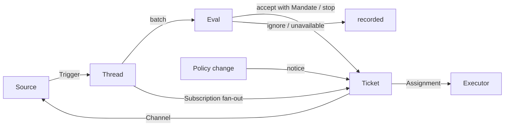

# 001 领域模型

本文档定义了 `dsh-superagent` 的核心概念，以及每个概念各自负责维护的规则。代码、智能体调用的工具、面板以及其他文档都只使用这些术语，而不引入别的叫法。遵循 [000 理念](000-philosophy_cn.md)，这个模型只保留工作真正需要的概念；业务需求要么成为其中某个概念的属性，要么由提示词来表达。

## 流程

工作从 Trigger 流向 Eval，再进入执行。Source 产生 Trigger。Trigger 会作为上下文，扇出到订阅了其所属 Thread 的 Ticket。以这种方式到达 Ticket 的人的消息，会留在这个 Ticket 内处理；其他 Trigger 都会进入 Eval，由 Eval 决定它是否要启动新的工作。Eval 一旦接单，就会创建一个带有 Mandate 的 Ticket。Assignment 把 Ticket 交给 Executor 执行，结果再通过 Channel 回到 Source。

## 概念

Source、Thread、Eval、Mandate 和 Subscription 构成核心领域，其余概念则围绕它们提供支持。

| 概念 | 定义 | 它维护的规则 | 它存在的原因 |
| --- | --- | --- | --- |
| Source | 一个事件流。Source kind 是一种可复用实现；Source instance 是这个 kind 的某个具体配置：是否运行、监听什么 | 维护自己的读取位置和机器人自身身份。定义什么算事件，包括那些只有在时间维度上才能成立的条件。会在 Trigger 进入领域前，先丢掉机器人自己发出的消息，以及不在监听范围内的 Trigger。把每个 Trigger 翻译成它所属的 Threads，以及可回复的 Channel 地址 | 重启时不能重复重放事件 |
| Trigger | 一条不可变事件，并带有 Source 自己的元数据，比如 actor | 属于一个或多个 Thread。对同一个 Trigger 重复接单，仍只创建一个 Ticket | 它是审计和幂等的基本单位 |
| Thread | 按时间排序的一组 Trigger；由 Source 定义哪些 Trigger 属于同一个 Thread | 同一时刻最多只有一个 Eval 在其上运行。一个 Thread 可以有多个 Ticket。它保存自己的 Subscriptions、当前运行的 Eval，以及 Decision 历史 | 让 Eval 拥有一致视图和上下文 |
| Correlation | 一个 Trigger 同时属于多个 Thread 时，这些 Thread 之间的关系 | 只增加上下文，不参与路由 | 让 Eval 能跟随相关证据 |
| Channel | Thread 的写侧；由 Source 定义它的地址 | 一个 Thread 可以有多个 Channel；Ticket 保存其中一组 | acknowledgement、reply、pull request 和 resolved review 本质上都是写操作 |
| Policy | 带版本的评估规则，以及每个 Source 自己的策略部分：谁可以通过这个 Source 发起工作、这些身份如何在该 Source 中表达、允许名单如何同步、哪些机器人可以产生 candidate | Policy version 覆盖规则、accept mode 和各 Source 的策略部分。凡是影响到活跃 Ticket 的变更，比如它最初匹配的某条规则被修改，都会作为输入送达它的 Assignment；但不会立即撤销已有 Mandate。不同 Source 上的身份不会互相映射 | 规则变更后，正在运行的 Eval 必须被丢弃 |
| Eval | 对一批 Trigger 的判断，由两层组成：gate 和 assessment | 输入为：Trigger 批次、Thread 快照、该 Thread 上所有 Ticket（包括已结束的）以及当前 Policy。输出为一个 Decision。本身不持有状态 | 它决定是否开启、继续或停止新工作 |
| Mandate | 一次 accept 所授予的内容：Policy version、scope、strength、匹配到的规则、发送者在该 Source 上的身份，以及 Source 接收这个 Trigger 的方式 | 不可变；如果 scope 变宽，就必须创建新 Ticket。Ticket 结束并不意味着 Mandate 结束：只有人的 stop 会撤销它；Policy 不再支持它时会使其失效。已结束 Ticket 恢复前，要按当前 Policy 重新校验 | 它说明为什么这项工作可以做、以及能做到什么范围 |
| Ticket | 一项被授权的工作单元 | 只能由 Eval 创建。引用自己的 Mandate；保存 Channels 和 Inputs。状态在 open → ended 之间流转；若人在它某个 Thread 上发消息，且这个 Ticket 没被人停止，就可以从 ended 回到 open。它定义自己的状态，而不是跟随 Executor 的状态 | 它拥有执行过程及其报告 |
| Assignment | Ticket 与某个 Executor 实例的一次绑定 | 一个 Ticket 随时间可能有多个 Assignment。Assignment 独立于 Ticket，在 pending → running → ended 之间流转。只有它的最终报告，才可能从 Executor 侧结束 Ticket | Executor 在领域外，但“由谁执行”这个事实必须被领域保存 |
| Subscription | Ticket 与 Thread 之间的多对多关系，保存在 Thread 上 | 匹配到的 Trigger 会扇出给每个仍然存活且已订阅的 Ticket，不检查消息是谁发的；以这种方式到达 Ticket 的人的消息不会进入 Eval。Executor 仅为上下文而跟随的 Thread，也会同样把消息送达 Ticket，但不会赋予任何权限，也不会让已结束 Ticket 恢复。即使 Ticket 已结束，它依然保留自己的 Subscriptions，包括已经关闭或合并的 PR；人的消息会在不经过 Eval 或 Decision 的情况下，以同一 Mandate 恢复它；机器人和 CI 的消息不会如此触发，因为 Executor 恢复时会重新读取这些 Thread。一个被人停止的 Ticket 不再接收任何消息。只有当某条消息明确指向某个 Ticket 时，主 Session 才会把该 Thread attach 到一个已存在 Ticket 上。人可以移除某个 Thread 上的所有 Subscription；Executor 只能移除自己 Ticket 对某个“不相关” Thread 的 Subscription，但不能移除 Ticket 启动所在的 Thread，也不能移除 Source 主动为它绑定的 Thread（比如它自己的 PR） | 这样后续讨论无需再次提及智能体，也能送达 Executor |

“人”不是一个领域概念。Trigger 只携带 actor 的标识，这个标识来自 Source 自己的表达方式。允许名单属于 Source 自己在 Policy 中的一部分，也使用这个 Source 自己的身份体系。至于“同一个人在多个 Source 上对应哪些账号”，那是提示词中的知识，而不是领域模型中的实体。

Executor 本身及其 Sessions、目录都在领域之外，通过 Assignment 接入。

聚合关系如下：Source 拥有自己的读取位置。Thread 拥有自己的 Subscriptions、当前运行的 Eval（串行运行，期间新增 Trigger 会合并进下一批），以及 Decision 历史。Ticket 拥有自己的 Assignments、Channels 和 Inputs，并通过 id 引用 Decisions。

## 被拒绝的概念

| 被拒绝项 | 原因 |
| --- | --- |
| 把 Principal 或 Membership 做成实体，或者跨 Source 映射身份 | “人”只是 Trigger 元数据；允许名单是 Source 的 Policy 部分；跨 Source 映射属于提示词知识 |
| 让 Eval 自己调度延迟触发的 Trigger | 需要等待的条件应实现为普通 Source，因此 Eval 绝不反向依赖 Source |
| Waiting 或 revoked 这样的 Eval 状态 | Waiting 属于 Source；超时的 Eval 要么把 Trigger 重新排队，要么以 `unavailable` 结束 |
| 每个 Thread 最多只有一个 live Ticket | 同一 Thread 可能承载多个彼此独立的工作；避免重复由 assessment 结合 Ticket 列表来处理 |
| 一个“append to Ticket”的 Decision | append 本质上就是 Subscription fan-out，不需要专门的 Eval |
| 对 Subscription 再做 admission 校验 | Subscription 覆盖的是整个 Thread；Mandate 已经把授权与上下文分开了 |
| 能路由的 Correlation | 真正负责路由的是 Subscription；Correlation 只增加上下文 |
| Ticket 状态跟随 DSH Session | 一个 Ticket 可能被移交、恢复，或由多个 Executor 执行，因此必须定义自己的状态 |
| 让 Executor 声明“有人要求停止” | 只有 Eval 能决定一次 stop 的强度 |
| 在 Policy 变更时取消运行中的 Ticket | 直接取消会留下半截工作；更合理的做法是记录变更并送达它 |
| 当 Executor failed/blocked 时锁死其所有工具 | 这会阻止人直接进入 Session 继续工作，也会阻止恢复后的汇报；暂停自动输入已经足够 |
| 从报告的自由文本里推断“正在等人” | 这种分类必须依赖结构化事实；Executor 应通过结构化字段提问 |

## 哪些部分是可复用的

上面的概念及其规则是可复用的。Source 的具体实现、Policy 的具体内容、Executor 的实现以及 Channel 的实现，则属于某个具体部署。每个 Source 在内部可以保留自己的术语，比如 message、chat、notification，然后统一翻译成 Trigger。

| 部分 | 在本仓库中的实现 |
| --- | --- |
| Source | 飞书：实时事件、历史恢复、订阅 topic 的轮询。GitHub：notifications、已订阅的 Issue 和 PR、CI 变化、PR 合并或关闭，以及在打开相应开关时，对仓库内所有新 Issue / PR / comment 和默认分支 CI 的监听 |
| Policy | assessment 规则，以及每个 Source 的允许名单、同步机制、bot 列表和 admission 表 |
| Executor | 每个 Ticket 一个 DSH Executor Session 和一个目录，运行在由 Executor 与 Sources 注册变量的执行环境中 |
| Channel | 飞书 topic 回复、GitHub 评论与 review thread 回复 |

## 术语表

下面是本文及后续文档会使用的术语对照表，并给出中文名称。后续文档会解释上文未展开的概念。面板一次只显示一种语言；点击 `(?)` 会打开包含中英文的术语表。智能体在 GitHub 和飞书上给人发的消息，使用的是自然语言，而不是这些术语。

| 术语 | 中文 | 含义 |
| --- | --- | --- |
| Agent | 智能体 | 由 `dsh-superagent` 运行的自动化团队成员，通过 GitHub 账号、飞书机器人等身份在 Source 上行动 |
| Main Session | 主 Session | 用于评估 Trigger、接单和分发 Ticket、以及进行回复的 DSH Session；代码和提示词中称为 `orchestrator` |
| Executor Session | 执行器 Session | Executor 为一个 Ticket 运行的 DSH Session；代码和提示词中称为 `worker` |
| Source | 来源 | 一个事件流：由插件提供的 kind，加上一份 instance 配置 |
| Trigger | 触发 | 来自某个 Source 的一条不可变事件 |
| Thread | 线程 | 按时间排序的一组 Trigger；也是 Eval 串行运行的单位 |
| Correlation | 关联 | 共享同一 Trigger 的多个 Thread 之间的关系；只增加上下文 |
| Channel | 渠道 | Thread 的写侧 |
| Policy | 策略 | 用于接单的带版本规则，以及每个 Source 自己的策略部分，比如谁可以在那里发起工作 |
| Policy version | 策略版本 | 某一组规则、Source 策略部分和 accept mode 组合出来的标识；每个 Mandate 都会记录它 |
| Eval | 评估 | 把一批 Trigger 转成一个 Decision 的过程 |
| Gate | 准入 | Eval 的第一层确定性判断：谁能发起工作，以及以何种强度发起 |
| Assessment | 研判 | Eval 过程中由模型给出的判断 |
| Decision | 决定 | Eval 的结果 |
| Mandate | 授权 | 一次 accept 授予的内容：强度、范围以及它依赖的策略版本 |
| Ticket | 工单 | 一项被授权的工作单元 |
| Assignment | 派工 | Ticket 与某个 Executor 实例的一次绑定 |
| Subscription | 订阅 | Ticket 与 Thread 的关系 |
| Fan-out | 扇出 | 把某个已订阅 Thread 上的 Trigger 作为上下文送达 Ticket |
| Executor | 执行器 | 用来运行 Assignment 的端口：每个 Ticket 一个 Executor Session 和一个目录 |
| Execution environment | 执行环境 | Executor Session 和 prepare command 运行的环境：由 Executor 和 Sources 注册的一组变量，每个变量都有 key、value 和 description |
| Report | 报告 | Assignment 向 Ticket 汇报的状态 |
| Attention | 待人工决定 | Ticket 上一个等待人回答的问题 |
| Disposition | 去向 | Trigger 被过滤、被评估或被扇出时留下的记录 |
| Input | 输入 | 送达 Ticket 的上下文：被扇出的 Trigger、Policy 变更、恢复和文本 |
| Scope | 范围 | Mandate 允许执行的工作范围 |
| Strength | 强度 | Mandate 或 Eval 的依据强弱 |

| 组别 | 取值 |
| --- | --- |
| Decision | accept 接单 · stop 停止 · ignore 忽略 · unavailable 未完成 |
| Strength | explicit 明确 · inferred 推断 |
| Assignment | pending 待启动 · running 执行中 · ended 已结束 |
| Report | progress 进展 · waiting 等待 · ready 就绪 · blocked 受阻 · failed 失败 · dropped 无需处理 |
