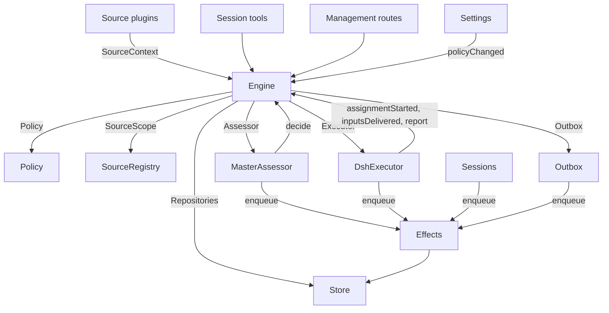

# 007 架构

本文档是实现层面的开发者指南。它把 [001 领域模型](001-domain_cn.md) 到 [006 部署](006-deployment_cn.md) 中的概念，映射到类、接口和文件。建议先从 runtime 和 Engine 开始，再把后面的模块表和测试表当作代码索引来使用。

## 核心类与胶水层

核心类负责持有领域概念，并通过小而明确的接口隔离外部边界。胶水层则把 tool 参数、HTTP 请求、Source payload 和 DeepSeek Harness 事件翻译成对这些核心类的调用，再把结果转换成 cards、views 和 messages。

`Runtime`（`src/app/runtime.ts`）是应用的 composition root，负责构造应用、注入依赖，并掌管启动与关闭。`Engine` 负责构造自己的内部 parts。由于 Executor 和 Assessor 需要回调 Engine，因此 Runtime 会把 getter 传给它们，而不是在构造时形成环依赖。

### Runtime

`Runtime` 是组合根；它本身不包含领域规则。其构造函数会锁定 state 目录、打开 Store，并构建各组件。如果构造失败，它会负责关闭 Store 并释放锁。

启动阶段会注册管理路由并执行 Setup。Setup 解决完毕后，Runtime 会安装 Session 和 Executor hooks，确保主 Session 存在，启动 Policy 同步，恢复中断的 Assignments，并启动 passes 与 effects。`ready` 表示整个启动流程完成。

关闭阶段会取消 turn，等待 passes、effects 和 agents 收尾，恢复进程环境，关闭 Store，并释放锁。Source plugins 通过窄接口 `SourceHost` 把 Runtime 作为 `orchestrator` 服务注入。

| 部件 | 模块 | 作用 |
| --- | --- | --- |
| Setup | `src/app/setup.ts` | 通过与 worker shell 相同的方式探测仓库和账号 CLI，解析 repository 与账号，写入并应用 workers 的环境和 command shims，并保存 setup problems；Settings 在检查变更后的账号时也会调用它，重启时也会重新经过它 |
| Passes | `src/app/passes.ts` | 单线程运行 pass：每 2 秒，以及每次收到命令请求时运行一次；处理 due effects，再执行 `Engine.evaluateDue`。Source 的 Trigger 也是通过它送进 Engine 的 |
| Outbox | `src/app/outbox.ts` | 实现 Engine 的 `Outbox` port，也是 receipts 的唯一写入者：`send` 会在一个事务里同时记录 receipt 并排入 `reply` effect；该 effect 再通过 `SourceRegistry.send` 实际发送；若 Source 关闭，消息会等待；若 conversation 消失或不再监听，则消息会被丢弃 |
| Notices | `src/app/notices.ts` | 把领域事件和 worker 活动转换成主 Session 的消息。`eventNotice` 处理领域 notice；`reportRelay` 会立即转发问题，把普通 progress 保存在 Ticket 上，并 relay 其他 report；`followupRelay` 会标记哪些 Ticket 正拥有某个人类 follow-up。若 relay 在 turn 进行中到达，它会通过 DeepSeek Harness inbox 在下一步一起送达 |

### Engine

`Engine`（`src/core/engine.ts`）是 Trigger、Thread、Decision、Ticket 与 Assignment 的唯一写入者。它通过 `src/core/ports.ts` 中的 ports 接收依赖：`Repositories`、一个获取当前 Policy 的 getter、`SourceScope`、`Assessor`、`Executor` 与 `Outbox`。可选依赖还包括 `prepareTicket`、`now` 与 `emit`。

Engine 的所有方法都是同步的。每条命令都会在一个事务中更新自己的 aggregates。`evaluateDue` 则为每个 Eval 或 Ticket 单独开事务。各 ports 会在事务内部登记“提交后执行”的外部工作，由 adapter 在 commit 后实际执行。非法请求会抛出 `UserError`。

Engine 只暴露一个入口，并把工作委托给 5 个内部 parts。每条命令的事务由 Engine 自己拥有。那些跨多个 part 的命令，比如 `attach`、`evaluateDue` 和 `policyChanged`，会按顺序调用这些 parts。

每个 part 都继承自 `EnginePart`（`src/core/part.ts`），它负责提供 options 和共享读取能力。这些 parts 之间的依赖单向流动：

| Part | 职责 | 依赖 |
| --- | --- | --- |
| `Intake` | 处理来自 Source 的 Trigger：只保存一次，记录 disposition，把它登记到对应 Threads 及其 correlations，并扇出给订阅该 Thread 的 Tickets；除非是一条已抵达某个 Ticket 的人的消息，否则会在 primary Thread 上排队进入 Eval | Tickets |
| `Evals` | 管理 Thread 上的 Eval：批处理、gate strength、actor、basis 以及对应的 primary Trigger；candidate 的 deadline 从 delivery 时刻开始，并能在 pause 时顺延；过期会 requeue，连续多次则记录为 unavailable；同时管理 candidates、replays、hand-backs 和最终 Decision：accept、stop、ignore 或 unavailable | Tickets |
| `Tickets` | 管理 Ticket 生命周期：从 accept 创建 Ticket 及其 Mandate、Subscriptions 和首个 Assignment；管理 Ticket 跟随的 Threads、这些 Threads 的关闭（`followsDone`）、attach 进来的 Threads、仅为上下文而 follow 的 Threads、Inputs 和 notes，以及 resume、retry、restart、stop、end，以及在 Policy change 下需要通知哪些 Tickets | Replies |
| `Assignments` | 接收并记录来自 Executor 及其 workers 的事实：Assignment 开始执行、Inputs 已送达或送达失败、restart 中断、worker 的 Report 及其中携带给人的问题 | Tickets, Replies |
| `Replies` | 通过 `Outbox` 向 Channel 写消息：acknowledgement、answer、result 与 attention，并按规则判断什么时候允许发这些消息 | 无 |

命令方法用祈使式名称，例如 `stopTicket`；由 adapter 报告的既成事实用过去式命名，例如 `assignmentStarted`。查询 `candidate` 使用名词形式。

调用方只会拿到与自己角色对应的 `Pick` 视图：`EngineForSources`、`EngineForMainSession`、`EngineForPeople`、`EngineForSettings` 或 `EngineForExecutor`。

| 角色 | 方法 | 效果 |
| --- | --- | --- |
| Sources | `receive(trigger)` | 只保存一个 Trigger，一旦成功会返回 `stored`；若重复则返回 `duplicate`；若没有任何 Source 愿意接收则为 `filtered`。它会把消息扇出给所有订阅对应 Threads 的 Tickets；其中人的消息若送达 ended Ticket，且 processing 未 paused 且 Mandate 仍有效，会直接 resume；否则会在 primary Thread 上排队等待 Eval |
| Sources | `bindThread(ticketId, thread, own)` | 让一个 open Ticket 开始跟随某个 Source 的 Thread，例如某个 PR 的 Thread；`own` 表示这个 Thread 是该 Ticket 自己打开的。若此前已关闭，则重新视作 open。真正结束 Ticket 的依据是这些 Threads 的 close，而不是某个 `ready` Report |
| Sources | `threadClosed(thread, outcome, at)` | 某个 Thread 被关闭：所有正在跟随它的 open Ticket 都会记录这次 close；一旦一个 Ticket 对自己需要 follow 的 Threads 满足 `followsDone`，就会结束：若它自己打开过 Thread，则要求所有自己打开的 Thread 都关闭；若自己没打开任何，则要求所有 follow 的 Thread 都关闭。最终 outcome 取这些 close 中最新的一次，但若 close 之后又出现了 resumed work、follow-up 被 acknowledgment/answer 但之后还未有非 progress Report，则不会立即结束 |
| Main Session | `candidate(triggerId)` | 返回包含某个 Trigger 的 Eval，格式与 assessor 看到的一致 |
| Main Session | `candidateDelivered(evalId)` | 记录 candidate 已送达主 Session，并从此刻开始计算其 deadline |
| Main Session | `decide(triggerId, outcome)` | 为一个 Eval 记录 Decision，或对一个 explicit request 直接做 Decision。accept 会原子性地创建 Ticket、Mandate、Assignment、Subscriptions 和 acknowledgement。若某个 inferred candidate 是从卡片上直接忽略的，则会记录 `ignoredFromCard`。当 `followupOwners` 仍拥有某个人类 follow-up 时，只允许 stop |
| Main Session | `attach(ticketId, triggerId, note?)` | 把一条明确指向某个 Ticket 的 Trigger 路由给它，让其 Executor 将其视为 follow-up 处理，并结束拥有它的 Eval；其中其他 Triggers 会等下一次新的 Eval。若 Ticket 已 ended，则在 processing 未 paused 时会立即 resume。一个仍由某个 Executor 持有的 follow-up 无法 attach；已经被某 Ticket hand back 过的消息也不能 attach 回同一 Ticket |
| Main Session | `requestStatus(ticketId)` | 请求一个处于 waiting 状态的 Executor Session 汇报当前状态，并返回是否已成功发起请求 |
| Main Session | `note(ticketId, text)` | 以纯文本 Input 的形式给某个 Ticket 的 Executor 发送一个来自其他工作的事实；该 note 不授予任何 authority |
| Main Session, Executor | `reply(request)` | 排队发送一条消息到某个 Channel，目的可以是 `acknowledgement`、`answer`、`result` 或 `attention` |
| People | `stopTicket(ticketId, reason?)` | 人工 stop，一个会撤回 Mandate 的动作 |
| People | `retryTicket(ticketId)` | 对一个在 `failed` / `blocked` Report 后正等待人的 Ticket，或者 Input delivery 失败、处于 `canRetry` 状态的 Ticket，结束其卡住的 Assignment，并启动新 Assignment |
| People | `reevaluate(triggerId)` | 把一个已存 Trigger 放回队列，进行新的 Eval |
| People | `unsubscribe(thread)` | 删除该 Thread 上的全部 Subscriptions；所有曾 follow 该 Thread 的 Tickets 也不再跟随它，但它们仍需负责自己已接到的 follow-up |
| People | `dismiss(decisionId)` | dismiss 一个 `unavailable` Decision 所代表的问题，并把这个 dismissal 记录在该 Decision 上 |
| Executor | `assignmentStarted(ticketId, assignmentId)` | 标记一个 Assignment 已开始运行；随后会把等待中的 Inputs 派发出去 |
| Executor | `inputsDelivered(ticketId, assignmentId, inputIds)` | 记录 Inputs 已成功送达 Executor Session；这些 Inputs 会等待下一步被真正消费 |
| Executor | `inputsRead(ticketId, inputIds)` | 记录某些 Inputs 已真正进入 Executor Session 的 history，即 model 已可见；只有后续出现 Report 或 turn end，这件事才算真正生效，哪怕期间经历了 restart |
| Executor | `turnEnded(ticketId, assignmentId)` | 某一轮 Executor turn 结束；若期间没有后台工作或无需 handoff，则它此前 claim 的 Inputs 会被视为已读 |
| Executor | `deliveryFailed(ticketId, assignmentId, error)` | 某些 Inputs 投递失败；这个状态会显示在 Ticket 上，直到投递成功、启动新 Assignment 或 Ticket 结束 |
| Executor | `report(ticketId, report)` | 记录一条 Report 以及其中给人的问题；若报告为 `dropped`，会结束 Ticket；若为 `ready` 且 Ticket 不 follow 任何 Thread，则完成 Ticket；若它已满足自己 follow 的 Threads 的结束条件，则也会按这些 Thread 的 close 结果结束 |
| Executor | `markUnrelated(ticketId, thread, reason)` | 对一个 attach 进来但后来发现不相关的 Thread，删除仅属于该 Ticket 的 Subscription，并把该 Ticket 在那上面拥有的 follow-ups hand back，同时附上 reason |
| Executor | `followForContext(ticketId, thread)` | 让一个 open Ticket 为上下文而 follow 某个相关 Thread：后续消息会送达 Ticket，但既不提供 follow-up strength，也不会恢复 ended Ticket |
| Executor | `handback(ticketId, triggerId, reason)` | 记录该 Ticket 把一条已到达自己的 Trigger hand back，并把它在所有 owner 释放后重新排队进入 Eval。返回值会说明是否真的入队。每条 Trigger 每个 Ticket 只能 hand back 一次，而且 Ticket 仍然保留 Subscription |
| Executor | `assignmentInterrupted(ticketId, assignmentId)` | 用于报告 host 停止时某个 Assignment 正在执行：若它在中断时仍忙碌，或者在最后一条 Report 之后还收到过 Input，就会带 recovery note 启动新的 Assignment，并把未真正拿进 history 的已投递 Inputs 一起重新送过去；否则保留原 Session。`DshExecutor` 在启动恢复时会按 Ticket 先后顺序报告这些中断，并重新排 pending launch |
| Passes | `evaluateDue()` | 在 processing 未 paused 时运行：启动所有 due Threads 的 Eval；对已过期的 Eval 进行 requeue，并在第三次连续过期时记为 unavailable；同时恢复那些在 pause 期间收到人的消息的 ended Tickets。若某个 Eval 的 candidate 尚未送达主 Session，则它不会过期。pause 期间不计算超时，恢复后整体顺延 deadline |
| Settings | `policyChanged(from, to, effects)` | 计算哪些 live Ticket 受本次 Policy 变更影响，并以何种方式受影响（见 `src/policy.ts` 中 `policyEffects`）；同时重启进行中的 Evals，使它们在新版本下重新运行 |

Engine 会把 batching、authorization、fan-out、resume 和 attention 生命周期等规则都封装在内部。一些共享谓词保证这些规则保持一致：

- `waitsForPerson`（`src/core/model.ts`）：最近一次 Assignment 报告为 `blocked` 或 `failed`，且之后还没有新的人的消息到达。自动 Inputs 和失败 launch 在此期间会被挂起。
- `followupOwners`：仍然负责某个人类 follow-up 的 Tickets 集合。即使 Ticket 已 ended，只要不是被人工 stop 且正等待 resume，也仍可能拥有这条消息。hand back 该消息时会失去 ownership。
- `settled`：某条请求是否已经被某个 Decision 最终解决；stop、unavailable、routed 和 refused-stop 不算 settled。
- `ticketStage`（`src/core/stage.ts`）：实现 [003 执行](003-execution_cn.md) 中的 stage 表。

当一个 Ticket 结束时，那些未读 follow-up 会重新回到 Eval，除非还有别的 Ticket 仍拥有它们，或已有其他 disposition 已经把它们 settle。被 acknowledgment、被 answer 和已 hand-back 的消息不会被重新评估。对于一些老记录，如果没有 acknowledgment disposition，则 outbox receipt 也会被用来判断。某次最终 Report 也会覆盖“Assignment 开始前就在等待的消息”，包括导致它恢复的那条消息。但 stop 一个 Ticket 的那条消息，不会被自动重新评估。

每次状态改变后，Engine 都会从 `src/core/ports.ts` 定义的 `DomainEvents` 中发出一个事件：

`trigger.received`、`eval.started`、`decision.recorded`、`ticket.created`、`ticket.resumed`、`ticket.ended`、`assignment.started`、`assignment.ended`、`thread.subscribed`、`thread.unsubscribed`、`trigger.requeued` 或 `policy.changed`。

Runtime 会把 `ticket.ended`、`trigger.requeued` 和 `thread.unsubscribed` 转换成 notice。送达到 Tickets 的人工 `trigger.received` 会变成 follow-up relay。对于 merged 或 closed 的 Ticket，`pullEndNotices` 会发送一条带稳定 id 的聊天 notice。其他事件目前没有消费者。

### Model

`src/core/model.ts` 保存所有领域类型；`src/core/stage.ts` 保存 Ticket stages。一个 Decision 会通过 `reason` 记录自己的原因；`reason` 是 `src/core/reasons.ts` 中 `Reason` 的列表：每个包含一个 `code`、其 `values`，并可选地指向该 batch 中的某个 `triggerId`。

核心层自带的 reasons，例如 `timeout`、`policyChanged`、`routed` 与 `startedTicket`，都定义在 `REASONS` 中，并通过 `reasonText` 提供英文文本供 agents 读取；gate 或 Source scope 也可以提供自己的 code，例如 `not_a_member`；而 `said` 则携带 assessor 或人工写下的文字。面板会通过 `reason.<code>` 把这些 code 本地化显示；Source 过滤掉的 Trigger 也会以同样方式记录对应 code。

Ticket 会把每个事实只保存一次。只要还没有 `ended` 记录，它就是 open 的；`ended` 记录会保存结束时间、由谁结束、为什么结束，以及 outcome。一个 Ticket “最后说过什么”，由其最新 Assignment Report（`latestReport`）决定；其 Executor Session 的 id 由 Ticket 派生而来（`src/executor/dsh.ts` 中的 `workerSessionId`）。

Ticket 的字段是有类型的：`origin` 记录了让某个 Eval batch 获得强度的 admissible Trigger 及整批 Triggers（`triggerId`, `triggerIds`）；`execution` 记录 Executor 的选择（`name`、`directory` 和当前 `assignment`）；`delivery` 记录最近一次失败的 Input delivery（`error`, `at`），直到某次 delivery 成功、某个新 Assignment 开始，或 Ticket 结束为止；`follows` 记录 Ticket 正在跟随的 Threads，每项为 `{thread, own, closed?}`：`own` 表示该 Thread 由 Ticket 自己打开；若已关闭，`closed` 中记录 `at` 与 `outcome`。只有 Tickets part 能写 `follows`；GitHub Source 则通过 `src/sources/github-pull.ts` 中的 `pullsOf` 与 `pullOf` 读取对应 PR。

一个承载 Trigger 的 Input 会额外记录该 Trigger 是否由人发出，这也是 `waitsForPerson` 的判断依据。Thread 还会在 `context` 中列出那些只为上下文而订阅它的 Tickets，并在 `expired` 中统计“它的 queued Triggers 所经历的连续 Eval 超时次数”；而一个 Evaluation 会记录自己的 `primary` Trigger，以及 candidate 何时被 `delivered`。

一个 Trigger 的 disposition 会记录：它送达了哪些 Tickets（无论是 fan-out 还是 attach）、是否被人工 requeue、有哪些 Tickets hand back 过它，以及哪些 Tickets 的 Executor 对它做过 acknowledgement 或 answer。

Mandate 的 `basis`（`MandateBasis`）会记录 gate 当时是如何接受它的。revalidation 会查看接收时的 `source`、`scope` 与 `row`、被列出的 `sender`、匹配到的 `rules`，以及 `via`：

| `via` | 准入依据 |
| --- | --- |
| `addressed` | 一个在允许名单中的 sender 明确指向了智能体 |
| `followup` | 一条消息出现在已有 Tickets 的 Thread 上 |
| `admission` | 来自 admission table 的某个 cell；`observation` 表示它是 inferred candidate |
| `bot` | 一个被列出的 bot 产生了 inferred candidate |

Trigger 与 Thread 的 `meta` 都属于 Source 所有。核心层不会解释这些字段。

### Policy

`src/policy.ts` 定义 settings schema、授权与 assessment 规则。`settingsPolicy(settings, scope)` 每次都会返回一个新的、无状态的 `Policy`：

- `version`、`paused` 和 `evalTimeoutMs` 描述当前状态。
- `gate(trigger, thread, tickets)` 返回准入强度与准入依据。
- `revalidate(mandate)` 检查一个已有 Mandate 在当前 Policy 下是否仍然成立。
- `admitsInferred(rules)` 用于判断在当前 accept mode 与规则配置下，主动工作是否允许被 accept。

`assessmentOutcome(assessment, settings, strength)` 负责把模型给出的 assessment 结果转换成 Engine 的 outcome。它要求：每条启用规则都必须有 judgement、direction 必须是 settled 的、至少有一条规则匹配，并且存在足够的 intent evidence。在非 `auto` 模式下，一个 inferred accept 会被降级为“would accept”的记录。

`policyEffects(tickets, old, now, scope)` 负责找出哪些 open Tickets 会受到某次 Policy change 影响，以及影响方式。`Engine.policyChanged` 只会通知这些 Tickets。`policyVersion` 会对 rules、accept mode 以及各 Source 的 Policy 部分（包括 bot list）做哈希。

### Store

`Store`（`src/app/store.ts`）独占一个 SQLite 数据库。Runtime 会先获取目录锁，再打开它，从而避免第二个进程对同一份状态进行迁移或写入。

它的接口按用途分组：

- **领域仓库：** `atomic`，以及 `triggers`、`threads`、`tickets` 与 `decisions`，每个都提供 `get`、`save` 和 list queries。经过索引优化的 working sets 包括 `threads.active()`、`tickets.open()`、`tickets.active()` 与 `read.subscribedThreads`。
- **只读查询：** `read` 为 views、tools 与 Source polling 提供诸如 `threadTriggers`、`triggerStats`、`search`、`droppedReplies` 等方法。这些方法永不写入。
- **Source 元数据：** `threads.describe` 与 `threads.patchMeta` 用于更新归 Source 所有的 Thread metadata。
- **Settings：** `settings`、`saveSettings`、`blockRevision` 和 `settingsHistory`。Settings 与 prompts 使用 `src/app/versions.ts` 中的编号快照。
- **Outbox receipts：** `replyStatus` 与 `receipts`，只由 Outbox 写入。receipt 提供 `get`、`waiting`、`behind`、`add`、`settle` 与 `withdraw`。`behind` 用于检查“同一 Ticket、同一 conversation 上是否有更早的消息仍在等待且失败次数未达 3 次”。一条被 withdrawn 的消息会以 `channelGone` 或 `channelIgnored` 结算。只读查询可通过 `failingReplies`、`droppedReplies` 与 `droppedSince` 暴露失败或 dropped replies。
- **类型化 KV 记录：** `get`、`set`、`delete` 与 `keys`，类型都来自 `KV`。

`afterCommit` 用于确保某个动作只在事务成功提交后运行，若事务回滚则不会执行。Runtime 总是按记录的原始 shape 读取数据；schema 11 的迁移会在启动时把较老但仍受支持的记录转成当前 shape。

### Effects

`Effects`（`src/app/effects.ts`）是持久化的 side-effect 队列。某个命令会在自己的事务里调用 `enqueue(kind, key, payload)`；只有在事务真正 commit 之后，这项副作用才会开始执行。

同一个 `kind/key` 对应队列中的一行。若相同 key 的 waiting effect 被再次入队，则会替换 payload，并立即变为 due，但不改变队列顺序。`handle(kind, run, options)` 用于为某个 kind 注册唯一的 handler。处理时按 due 的顺序，从旧到新执行，受并发限制控制。

失败会按指数退避重试。抛出 `Later` 则表示暂缓，而不计入失败次数，例如当前没有可用 worker slot。`start` 在 setup 完成后开启处理；`drain` 在关闭时停止处理但保留等待中的 rows；`pending` 与 `idle` 用于暴露队列状态。

| Kind | Handler | 作用 | 并发 | 重试 |
| --- | --- | --- | --- | --- |
| `assessment` | MasterAssessor | 把 Eval candidate card 注入主 Session turn，然后告知 Engine 它已 delivered，从而启动 Eval deadline | 4；paused 时不运行 | 2 秒起，指数退避到 60 秒 |
| `launch` | DshExecutor | 启动一个 pending Assignment：prepare command、Executor Session、assignment message | 等于空闲 worker slots；paused 时不运行 | 模型 provider 或网络的暂时性故障会从 5 秒起退避到 300 秒，最多 3 次；其他失败以及 prepare command 失败会直接让 Ticket failed；因 pause 或满 worker slots 而被 hold 的情况，则 5 秒后重试 |
| `delivery` | DshExecutor | 按顺序把等待中的 Inputs 送到正在运行的 Assignment | 4；paused 时不运行 | 2 秒起，退避到 60 秒；若只是等 slot，则 2 秒后重试 |
| `relay` | Sessions | 把 worker 的 report / question 或人的 follow-up 注入主 Session turn | 1，按队列顺序 | 2 秒起，退避到 60 秒 |
| `notice` | Sessions | 在不唤醒主 Session 的情况下插入 notice | 1，按队列顺序 | 2 秒起，退避到 60 秒 |
| `reply` | Outbox | 通过对应 Source 把一条 Channel message 发送出去；要求该 Ticket 在同一 conversation 中更早排队的消息都已发送成功或失败 3 次；若消息被 withdraw，则发送会被取消 | 1；paused 时不运行 | 5 秒起，退避到 300 秒；若 Source 当前关闭，或被更早消息阻塞，则 5 秒后重试 |

每种 kind 在 health 中都有自己的 entry。一旦某种 effect 有某一项连续失败 3 次，就会报告 error；唯一例外是 `delivery`，其失败会显示在对应 Ticket 上。relays 内部顺序严格保持，notices 内部顺序也严格保持；一项失败会阻塞其后同类项。

### Sources

Sources 通过 `src/sources/kind.ts` 中定义的 `SourceKind` 协议来扩展宿主。一个 kind 需要声明自己的 `kind`、`title`、`description`、配置 `schema` 与 `fields`、可推导 `facts`，以及它会使用的 `health` entries。可选能力还包括 `scope`、`channel`（`allowed`、`send`、`link`）、`threadContext`、`find`、`policy`、`environment` 和 `refreshLabels`。

`SourceRegistry`（`registry.ts`）拥有所有已注册 kinds 和已保存 instances，并实现 Engine 依赖的 `SourceScope`。注册过程会在 `HealthBoard` 上占用声明的 health entry；重复声明、或尝试使用保留的 `sync:` 名称，都会被拒绝。`SourceContext` 只能向其 kind 自己占用的 entries 写健康状态，因此 Source 被卸载后，再晚到的健康上报也不会生效。

Registry 与配置相关的方法包括 `kind`、`instances`、`instance`、`validate`、`validatePolicy`、`policyPart`、`channelAllowed`、`declarations`、`environments`、`find` 和 `scope`。其中 `find` 会调用每个支持搜索的 kind。

通用代码通过 registry 访问 Source 行为。`send(message, commands)` 会调用 kind 的 Channel，并返回 `sent`、`gone`，或者在 kind 尚未安装时返回 `waiting`。`link` 用于解析 Channel link。`threadContext` 会把 kind 的 reader 与其配置配对；若 kind 不支持上下文读取，则返回空。若某个已保存配置无法通过 schema 校验，则对应 instance 会被禁用。

plugins 接收到的是 `SourceHost`：也就是 registry 以及 `context(kind)`。而 kind 自己的实现代码看到的是更窄的 `SourceContext`，由 `src/app/source-context.ts` 中的 `sourceContextOf` 构造。

这个 `SourceContext` 提供 deployment 与 commands、setup readiness（`ready`、`configured`、`problem`）、配置读取、`receive`、`atomic` 和类型化的 `state`。它还暴露 Thread 读取与 metadata 写入、Ticket 读取以及 `bindThread` / `threadClosed` 等命令、Trigger 读取、通过 Outbox 发 `notify`，以及对已声明 health entries 的 `report`。

### DshExecutor

`DshExecutor`（`src/executor/dsh.ts`）为每个 Ticket 提供一个独立 Session 和目录。`start` 与 `deliver` 会分别入队 `launch` 与 `delivery` effects。`stop` 会通过 `Store.afterCommit` 在事务提交后取消 turn，从而保证“如果结束回滚了，就不会误杀 worker”。

`prepare(ticket, outcome)` 实现了 Engine 的 `prepareTicket` hook：它负责生成 short name、directory，以及 `ticketExecution` 所需的 assignment 文本。`workerSessionId(ticket.id)` 则负责导出对应 Session id。

`WorkerSlots` 会在 launch 开始前，或者某次 delivery 唤醒一个 idle worker 之前，预留并发容量。人的消息在 `maxWorkers` 之外还可额外占用一个 slot，并且唤醒操作优先于新 launch。`activeCount` 用于向面板报告当前负载。

暂时性的 provider 或网络故障会重试 3 次。launch 使用 effect backoff；若 turn 失败，则会在 15、30、60 秒后发送继续执行的 continuation message。`inputMessage` 会根据当前 Ticket state 渲染每个 Input；`mandateInstructions` 则会在 inferred work 的场景下补充匹配规则所要求的限制。

`install` 负责订阅 Session events；`dispose` 负责取消订阅。正常情况下，一个 turn end 会汇报 waiting；但如果刚完成 ready，或此时正等待人工动作，则不会。error 会汇报为 failed。启动时，`resume` 会通过 `assignmentInterrupted` 报告中断的 Assignments，并按 Ticket 先后顺序把那些不在等待人的 pending launches 重新排队。

### MasterAssessor

`MasterAssessor`（`src/app/assessment.ts`）使主 Session 可以对主动 candidate 做 assessment。`request` 负责排 assessment effect；`release` 则在对应 Eval 结束时释放缓存状态。

它的 `context`、`read` 和 `decide` 方法分别服务于 `orchestrator_eval`、`orchestrator_eval_read` 与 `orchestrator_eval_decide`。它们通过 `SourceRegistry.threadContext` 提供受限的 Thread 上下文、仓库上下文，以及决策提交能力。若某个 kind 不支持 Thread 上下文，则 assessment 只能看到 Trigger 本身及其 batch。

`assessmentOutcome` 会把模型的回答转成给 `Engine.decide` 使用的 outcome。`Evals` part 还会再次对 inferred accept 按当前 Policy 做复检。

### Settings

`Settings`（`src/app/settings.ts`）负责读取和写入带 revision 的 settings blocks。`current` 与 `view` 负责读取；`save(block, value, revision, origin)` 负责校验并保存；`pause(paused, origin)` 则修改独立的 `paused` 设置。

每次保存都必须声明来源：`panel`、`tool` 或 `sync`。只有 `panel` 允许修改执行环境或 `SETUP_FIELDS`（定义在 `src/deployment.ts`）中列出的 setup 相关字段。

当 Policy version 改变时，Settings 会先计算 `policyEffects`，记录本次修改影响了哪些 Tickets，然后调用 `Engine.policyChanged`。`syncable` 与 `sync(id)` 负责刷新某个 Source 的 Policy part；`refreshLabels(id)` 用于刷新 display names。

### Prompts

`Prompts`（`src/app/prompts.ts`）把 prompt 配置也保存成 `Versions`。`current`、`version` 与 `history` 负责读取；`validate`、`preview` 与 `save(value, baseRevision, source)` 负责校验和保存。`compose` 与 `skills` 负责最终给 Sessions 生成文本。

`builtInParts` 枚举了所有可 override 的内建 parts：包括它们的 key、角色、默认文本以及必须保留的模板占位符。每个 override 都会保存自己的 team `text`，以及所基于的 `base`（即原始默认值的 `builtInBase` key）。保存时，这些默认文本也会被保存在 `KV.prompts.builtIn` 中。之后 `defaultChanged` 就能报告哪些默认值发生了变化，以及在可能的情况下给出旧文本与新文本的差异。

校验逻辑会在省略 base 时沿用已保存 override 的 base；会自动忽略那些已在当前配置中出现、但已经被移除的 parts；同时拒绝空文本和其他未知 keys。这使得 save tool 可以安全 round-trip 自己读出的配置。`environmentSection` 与 `policySection` 会用自己的 keys 进行模板替换。没有 override 的配置会直接使用默认值。

### Sessions

`Sessions`（`src/app/sessions.ts`）同时管理主 Session 与 worker Sessions。`ensure` 会用对应角色的 model 创建 Session。`install` 会跟踪 agent events，并为 managed Sessions 注册 prompts、skills 和 tools。

`prompt` 保证每个 request id 只投递一次。`relay` 与 `notify` 会入队主 Session 消息，由 `relay` 与 `notice` effects 处理。具体内容由 `src/app/notices.ts` 定义；`delivery` 则用于检查某条消息是否已真正送达。

每次模型请求，Session 都会绑定到当前 prompt revision。它曾使用过的 revisions 会被持久化记录：`promptVersion` 标识当前 active 版本，`mayRead` 则限制某个 worker 能读取哪些历史版本。各类 registrations 会按 agent 保存在独立 map 中。

`status` 与 `promptVersion` 支持 prompt 相关页面。保存 prompt 通过 `Prompts.save` 完成，并会通知主 Session。`modelRetry` 暴露模型预算重试相关状态。

### Glue

| Glue | 翻译了什么 |
| --- | --- |
| `src/app/runtime.ts` | 组合根：用各部分真正依赖的接口来构造它们，注册 routes 与 Source host，并负责启动 / 停止 `dsh-superagent` |
| `src/app/notices.ts` | 把领域事件和 worker report 翻译成主 Session 的 notices 与 relays |
| `src/app/tools/main.ts`, `src/app/tools/executor.ts` | 把主 Session / Executor Session 的 tool 参数翻译成对核心类的调用，并把结果整理成 cards |
| `src/app/http.ts`, `src/app/views/`, `src/app/api.ts` | 把 HTTP 请求翻译成调用，把 Store 读取翻译成面板 views；`api.ts` 还为每个 route 提供静态类型 |
| `src/app/resources.ts`, `src/app/links.ts`, `src/app/cards.ts` | 把资源名翻译成读取逻辑，把 Source message 翻译成 links，把 records 翻译成适合模型读取的紧凑 cards |
| `src/sources/github*.ts`, `src/sources/feishu*.ts`, `src/sources/poll.ts` | 把 GitHub / Feishu payload 翻译成 Triggers 与 Thread facts，再把外发消息翻译成 CLI 调用 |
| `src/deployment.ts`, `src/setup.ts`, `src/infra/` | Setup probes 与 setup problems、CLI transport、以及智能体进程环境 |

## 依赖规则

- **依赖显式且收窄。** 每个类都只接收自己真正使用的接口，通常通过其他类的 `Pick` 类型来表达，例如核心类使用的 `ExecutorHost`、`AssessorHost`、`SessionsHost`、`SettingsHost`、`SetupHost`、`PassesHost` 与 `OutboxHost`，以及胶水层使用的 `HttpHost`、`MainToolsHost`、`ExecutorToolsHost`、`ResourceHost`、`LinkHost` 和 `SourceContextDeps`。Runtime 只会通过这些窄接口把自己传下去。Source plugin 注入的 `orchestrator` 服务，在类型上被声明为 `SourceHost`：只包含 registry 和 `context(kind)`；而 kind 自己只能看到自己的 `SourceContext`。
- **什么可以 import 什么。** `src/core` 除了 Node 自带的哈希模块外，不 import 自己之外的任何内容，也不做 I/O。`src/sources` 不能 import `src/app`。面板只能 import 宿主侧的 types，以及 `src/admission.ts`、`src/limits.ts`、`src/setup.ts`、`src/navigation.ts`、`src/sources/host.ts`、`src/core/errors.ts`、`src/core/reasons.ts` 这些纯值模块，以及 `src/app/api.ts` 中导出的过滤器列表。
- **每种状态只有一个写入者。** 每类状态只能由一个地方写，其他地方只能读取它，或通过接口请求该写入者代写。

  | 状态 | 唯一写入者 |
  | --- | --- |
  | Triggers、Threads、Decisions、Tickets、Assignments | Engine |
  | Source 的 read positions，以及它保存在 Threads 上的 meta（`label`、`url`、`facts` 和其他自有 key） | 各自的 Source，通过 `SourceContext` |
  | Settings 及其历史 | Settings |
  | Prompt versions | Prompts |
  | Effect rows | Effects |
  | Outbox receipts | Outbox：Engine 的回复和 Sources 的 `notify` 都经由其 `send`，并由 `reply` effects 结算 |
  | 某个 health entry | 在 `HealthBoard`（`src/infra/health.ts`）上占有它的那个部件；它会拒绝第二个写入者：`runtime` 由 Runtime 写，`evals` 由 Runtime 在每次 pass 后写，`models` 由 Sessions 写，每种 effect kind 由 Effects 写，某个 Source kind 的 entries 由 SourceRegistry 为该 kind 写，`sync:<id>` 由 Settings 写 |

  Source 想修改 Ticket，只能通过 `SourceContext.tickets.bindThread` 和 `threadClosed`，而这两个方法最终都会回到 Engine。
- **请求和事实分离。** “要求系统做一件事”的方法，用祈使动词命名，如 `stopTicket` 或 `bindThread`，因此可能被拒绝；“记录某个 adapter 已经做成了一件事”的方法，用过去时命名，如 `assignmentStarted` 或 `deliveryFailed`。每个 host 拿到的 Engine 也都是自己角色对应的窄接口视图。
- **类型化字段，以及 Source 数据归 Source 所有。** 代码只读取 Ticket 和 Mandate 上那些有明确定义的字段。Source 不在 Ticket 上额外存自己的数据：一个 Ticket 跟随了哪些 Thread，保存在 Ticket 自身的 `follows` 字段；Trigger 或 Thread 上由 Source 自己维护的内容，都在它们的 `meta` 中。
- **固定拒绝。** 任何可由人或 agent 触发的拒绝，都用 `UserError(code, values)` 来表示，其 code 来自 `src/core/errors.ts` 中的 `USER_ERRORS`。Management API 对 `missing` 用 404 响应，其余 `UserError` 用 400 响应；面板再把这些 code 本地化。setup problems 则使用 `src/setup.ts` 中的 `SetupError` code，以及 `src/sources/host.ts` 中固定的 `HealthCode`，并以同样方式本地化。

### Source 特有依赖

即便有通用抽象，仍有少量通用模块直接提到了 GitHub 或 Feishu：

- Outbox 会应用飞书 chat 的字数限制。
- `src/app/links.ts` 解析飞书 message link 和 `repliedTo`；它与 Runtime 都会通过 `feishuSettings` 读取相关 settings。
- `src/app/resources.ts` 会读取 `feishu/` 与 `github/` 原始资源；`src/app/cards.ts` 会用 `pullOf` 构造 Ticket card。
- Runtime 会为 merged 或 closed 的 Ticket 发送 `pullEndNotices`。
- Executor tools 会通过 `readPull` 和 `claimPull` 绑定 report 中提到的 pull request，这些 GitHub 上下文由 Runtime 暴露。
- MasterAssessor 通过 `readRepositoryPath` 读取仓库文件。
- Sessions 与 Prompts 只为 GitHub 和 Feishu 注册内建 skills。迁移逻辑也会处理它们在 schema 10 中的旧记录。
- Setup 只探测 GitHub 和 Feishu 的账号字段（`SETUP_FIELDS`）。也只有这些 Sources 能通过 `SourceContext.problem` 获得账号级 setup problem。

## 模块

| 路径 | 职责 |
| --- | --- |
| `src/index.ts` | 主插件入口：读取 machine settings、启动 Runtime，并把“账号字段变更后如何 restart”这件事交给它 |
| `src/deployment.ts` | 插件 `Config` 与 `Machine`；`resolveDeployment` 与 `resolveFeishuBot` 会像 worker shell 一样探测 CLI 并解析 repository 和账号；`SETUP_FIELDS` 列出 setup 会读取的 Source 字段 |
| `src/setup.ts` | setup problems 定义：`SetupError`，包含 code、修复位置，以及日志 / 主 Session / 面板共用的英文文本 |
| `src/policy.ts` | Policy：各 settings block 的 schema、Policy version、gate 和 Mandate revalidation |
| `src/admission.ts` | admission table 的值、每个 cell 的选项与默认值，并与面板共享 |
| `src/limits.ts` | 人能设置的各种上限；既供 settings schema 校验，也供面板控件展示 |
| `src/kv.ts` | `KV`：所有 kv 记录族的 key、value 类型与 owner，以及 Store 与 `SourceContext.state` 使用的 `Key` / `Family` 类型 |
| `src/navigation.ts` | 从面板打开一个 DeepSeek Harness Session，前提是 host catalog 中已列出它 |
| `src/core/model.ts` | 领域类型定义，包括 Ticket 的类型化字段与 `MandateBasis`，以及 `threadKey`、`ticketOutcome`、`reached`、`followupOwners`、`settled`、`waitsForPerson`、`liveTicket`、`runningAssignment`、`latestAssignment`、`latestReport` 等辅助函数 |
| `src/core/ports.ts` | 端口定义：`Repositories`、`Policy`、`SourceScope`、`Assessor`、`Executor`、`Outbox` 及所有领域事件 |
| `src/core/engine.ts` | Engine，本核心层的唯一入口，以及五种角色视图接口：`EngineForSources`、`EngineForMainSession`、`EngineForPeople`、`EngineForSettings` 与 `EngineForExecutor` |
| `src/core/part.ts` | `EnginePart` 基类，以及 `EngineOptions` |
| `src/core/intake.ts` | `Intake`：处理来自 Sources 的 Trigger，并把它们送给对应 Tickets 或送入 Eval |
| `src/core/evals.ts` | `Evals`：管理 Threads 上的 Eval 及其 Decisions |
| `src/core/tickets.ts` | `Tickets`：管理 Ticket 生命周期、其跟随的 Threads、Subscriptions 和 Inputs |
| `src/core/assignments.ts` | `Assignments`：记录 Executor 及其 workers 上报的事实 |
| `src/core/replies.ts` | `Replies`：负责核心层发往 Channel 的消息 |
| `src/core/stage.ts` | `ticketStage` 与 `canRetry`：实现 [003 执行](003-execution_cn.md) 中的 Ticket stages |
| `src/core/errors.ts` | `UserError` 与 `USER_ERRORS` |
| `src/core/reasons.ts` | `Reason`、`REASONS` 与 `reasonText`：解释核心层为何记录某个 Decision 或搁置某个 Trigger |
| `src/core/ids.ts` | `key`：从输入稳定派生 id；相同输入一定得到相同输出 |
| `src/core/memory.ts` | `MemoryRepositories`：使用内存模拟 Store 的仓库层，顺序和嵌套 rollback 语义都与真正的 Store 保持一致，用于领域测试 |
| `src/core/index.ts` | 核心层导出 |
| `src/app/runtime.ts` | Runtime，整个应用的组合根，以及它的启动 / 停止逻辑 |
| `src/app/setup.ts` | setup 本身，以及 `setupChanged`：判断某次 settings save 是否改动了 setup 关注的字段 |
| `src/app/passes.ts` | Passes 与调度器 |
| `src/app/outbox.ts` | Outbox：实现 Engine 的 `Outbox` port、管理 receipts，并执行 `reply` effects |
| `src/app/notices.ts` | 主 Session 的 notices 与 relays：`eventNotice`、`reportRelay`、`resultRelay` 与 `followupRelay` |
| `src/app/store.ts` | Store，以及 `Receipt` 类型（outbox message 的收据） |
| `src/app/store-read.ts` | `storeReads`：供 views、tools 和 Sources 轮询使用的只读查询层 |
| `src/app/migration.ts` | schema 11 迁移：把 schema 10 的旧记录一次性转换成当前 shape，并拒绝更老的 schema |
| `src/app/effects.ts` | Effects 队列 |
| `src/app/versions.ts` | `Versions`：带 current 指针的编号快照存储，用于 settings 与 prompts |
| `src/app/cache.ts` | `TextCache`：一个带大小上限的内存文本缓存，按 LRU 淘汰 |
| `src/app/settings.ts` | Settings |
| `src/app/settings-history.ts` | `policyHistory`：记录每次保存 settings 相对上一版的变化 |
| `src/app/prompts.ts` | Prompts、`builtInParts` 以及构造 prompt 时的 `promptParts` 顺序 |
| `src/app/context.ts` | 内建 prompt 文本，从 `prompts/` 中读取；以及供 Sessions 读取的 transcript entries |
| `src/app/skill-files.ts` | 打包的文本资源：`promptFile` 会把按句存储的文件拼成段落；也负责打包内建 skills |
| `src/app/sessions.ts` | Sessions |
| `src/app/delivery.ts` | `AgentDelivery`：确保一条消息按 request id 只被送入某个 DeepSeek Harness agent 一次，即使 Session 被恢复 |
| `src/app/retry-health.ts` | `RetryHealth`：跟踪哪些 Sessions 正在等待 model budget retry，供 `models` health entry 使用 |
| `src/app/role-models.ts` | 解析 Eval 与 Executor 使用的 model，并在新建 Session 时为其 seed 正确角色的 model |
| `src/app/assessment.ts` | MasterAssessor、assessment schema，以及 `orchestrator_eval` 的窗口化响应 |
| `src/app/execution-environment.ts` | 执行环境：变量集合、Ticket 级值、目录根，以及 `src/app/prompts.ts` 用于填充模板的 prompt section 文本 |
| `src/app/source-context.ts` | `sourceContextOf`：为每个 Source kind 构造对应的 `SourceContext` |
| `src/app/links.ts` | `sourceLink`：跳到某个 Trigger 原始消息页面的链接，以及 `candidateCard` |
| `src/app/cards.ts` | 给模型看的紧凑 cards：Triggers、Tickets、Threads、Decisions，以及封闭的 Ticket card states `TICKET_STATES` 与 `textPage` |
| `src/app/resources.ts` | `RESOURCES` 与 `readResource`：定义 `orchestrator_read` 可读资源及两种角色能读取的内容 |
| `src/app/tools/tool.ts` | `Tool` 类型、两种角色共享的 `orchestrator_read`，以及 `AcknowledgementSchema` |
| `src/app/tools/main.ts` | 主 Session tools |
| `src/app/tools/executor.ts` | Executor Session tools |
| `src/app/http.ts` | `/orchestrator/api` 路由实现：same-origin 检查、请求限制以及各类失败对应的 status code |
| `src/app/api.ts` | `Api` 类型定义：为每个 route 描述 params、query、body 与 response；仅 import 类型，因此可被面板 bundle 直接复用 |
| `src/app/views/text.ts` | 视图层文本格式：单行 `preview` 与无 HTML 的 `markdown`，以及 `plain` 与 `readable` |
| `src/app/views/records.ts` | 各视图共用的数据行：Triggers、Tickets、Threads、Decisions、Channel links，以及某次读取里某个 follow-up 的 ownersOf |
| `src/app/views/tickets.ts` | 各阶段 Ticket 列表、单个 Ticket 页面、Mandate basis 事实和 Executor 负载 |
| `src/app/views/threads.ts` | Thread 列表、单个 Thread 的 timeline、搜索与 Decision 列表 |
| `src/app/views/sources.ts` | Source 状态页：每个 Source instance 的状态、最近一天的计数，以及那一天里被 filtered 或 dropped 的内容 |
| `src/app/views/settings.ts` | settings 页面视图：每个 block 及其 revision、每个 Source 的 settings 及其 form、以及执行环境 |
| `src/app/views/overview.ts` | Overview：需要人处理的 Tickets、系统问题、过去一天的流量以及 Executor 负载 |
| `src/executor/dsh.ts` | DshExecutor、`WorkerSlots`、`ticketExecution`、`inputMessage` 与 `mandateInstructions` |
| `src/executor/background.ts` | worker 的后台工作管理：Session 的 shell jobs（`ctx.jobs`）与 subagents（`ctx.subagents`）；包括 `runningJobs`、`untilQuiet`、`killJobs`、`collectJobs`、`stopSubagents`、`stopBackground`、`until`，以及记录“某个 worker 的 turn 是被其 subagents 停掉的”这一事实的 `cancelled` |
| `src/infra/commands.ts` | `Commands`：CLI transport，包括 `run`；受仓库限制和参数校验保护的 `api` 与 `pages`；bot 形式的 `lark`；以及 `git`。`CliError` 携带 CLI 输出中报告的 code；若命令没打印任何内容，则错误只会描述“如何失败”，不会暴露原始参数；`validItems` 则用来跳过并计数 malformed list items |
| `src/infra/environment.ts` | 智能体进程环境：command shims、git 配置与 credential helper、`runAsWorker`，以及对环境和 Ticket 目录的检查 |
| `src/infra/paths.ts` | 包根目录路径，即打包资源所在位置 |
| `src/infra/text.ts` | 词数与聊天消息长度限制、`fill` 和 `sameName` |
| `src/infra/health.ts` | `HealthBoard`：所有 health entries 的统一状态板，并强制“一项 health 只有一个 writer” |
| `src/sources/kind.ts` | `SourceKind` 协议 |
| `src/sources/registry.ts` | `SourceRegistry` |
| `src/sources/host.ts` | `SourceHost`、`SourceContext`、`Health`、`health` 以及固定的 health texts |
| `src/sources/poll.ts` | GitHub 与 Feishu 轮询的公共部分：`POLL_HORIZON_MS`、`polled`、`cursorAt` 与 `pollThreads`，其中 `pollThreads` 会把失败记录为 `pollError` 挂在对应 Thread 上 |
| `src/sources/github.ts` | GitHub kind 与 plugin entry，导出为 `./github-watch`：负责一轮 notifications polling、活跃 Tickets 关联 PR 及其 CI 的跟随，以及订阅 Threads 的轮询 |
| `src/sources/github-trigger.ts` | 把 GitHub comments、reviews、Issue bodies 与 CI 变化转换为 Triggers，并处理 GitHub 地址 |
| `src/sources/github-pull.ts` | Pull request 规则：决定 Ticket 应跟随哪些 PR（`claimPull`, `observePull`），以及如何把 PR close 上报给 Engine；同时实现 `pullEndNotices` |
| `src/sources/github-channel.ts` | GitHub Channel：发送 comments 与 review thread replies，并返回 `sent` 或 `gone` |
| `src/sources/github-read.ts` | 读取 CI 快照、仓库文件、`github/` 资源，以及 `githubThreadContext`，后者可按页提供 Issue / PR 对话 |
| `src/sources/feishu.ts` | Feishu kind 与 plugin entry，导出为 `./feishu-watch` |
| `src/sources/feishu-trigger.ts` | 把飞书消息转换为 Triggers，统一 live events、history pages 与 topic pages 的规则 |
| `src/sources/feishu-loops.ts` | Feishu 各循环：event consumer、历史恢复、chat 名称获取，以及订阅 topic 的轮询 |
| `src/sources/feishu-channel.ts` | Feishu Channel：发送 topic replies，并返回 `sent` 或 `gone` |
| `src/sources/feishu-read.ts` | `feishu/` 资源读取：某条 Trigger 的原始消息、其 root / parent / topic，以及 `feishuThreadContext`，并可把图片一并提供给 assessment |
| `src/sources/admission-context.ts` | assessment 的受限上下文窗口：通过 kind 的线程读取器获取 Trigger 所在线程的前几页，以及 Trigger 周围消息 |
| `src/sources/feishu-image.ts` | 把飞书消息中的图片作为附件读取给 assessing Session |
| `src/client/index.tsx` | client 插件入口：注册侧边栏入口、主面板，以及在 Plugin Manager 中显示的页面 |
| `src/client/app.tsx` | 面板主体：header、search、glossary、tabs 与当前 route 对应页面 |
| `src/client/provider.tsx` | 面板各页面共享的 host context：copy、API 调用、navigation、notices、state polling，以及 `restart` 期间快速刷新的逻辑 |
| `src/client/api.ts` | 对 management API 的 typed 调用与 polling，类型来自 `src/app/api.ts`；也包含 Eval status 的过滤器 |
| `src/client/route.ts` | tabs、settings groups、由 `parseRoute` 解析的 typed routes，以及“最后打开的 settings group”这类 route memory |
| `src/client/overview.tsx` | Overview 页面 |
| `src/client/source.tsx`, `trigger.tsx`, `eval.tsx`, `execution.tsx` | 各阶段各一页：显示状态；若有 settings，也在对应页面展示 |
| `src/client/thread.tsx`, `ticket.tsx` | 单条记录页：Thread 及其 timeline；Ticket 及其 authorization、Inputs 与 Assignments |
| `src/client/settings.tsx` | Settings 标签页：左侧 group 导航与当前 group 页面 |
| `src/client/settings-kit.tsx` | settings blocks 的基础组件：共享字段、`useBlockDraft`、各种表单项，以及保存历史 |
| `src/client/prompts.tsx` | Prompts settings：页面负责已读 view，自身 editor 负责 draft；`Edit`、`Full prompt` 与 `History` 三个 tab 分别渲染；被 override 的 built-in part 会显示 default change，并支持保留或移除 override |
| `src/client/prompt-config.ts` | prompt 配置的纯函数：按 section / team section / skill 名称 / built-in parts（`part/<key>`，可带 `withOverride`）与 headings 组织配置，并生成 full prompt 行级 diff |
| `src/client/deployment.tsx` | Deployment settings 页面，也用于 DeepSeek Harness 的 Plugin Manager |
| `src/client/draft.tsx` | settings drafts：`draftReducer`、各种 draft state 与与新 revision 合并的逻辑、`saveBarText` 及保存条 |
| `src/client/controls.tsx` | 一套本地复制的 DeepSeek Harness 控件：遵循其 markup、键盘行为与设计 token；由于 bundle 不直接引入 `@deepseek-ai/dsh-client-ui-primitives`，因此自己实现，但不读任何额外 context |
| `src/client/widgets.tsx` | 面板页面共用的小组件，会读取 panel context：sections、page heads、load states、times、links、带确认的 actions、setup check 与 Markdown 展示 |
| `src/client/rows.tsx` | 页面共用的数据行组件：Ticket、Thread 与 Decision 的行，Thread 的 chip，以及连续 automated messages 的折叠 |
| `src/client/markdown.ts` | 报告与问题中允许的 Markdown 子集，以及裸地址链接的解析 |
| `src/client/text.ts` | 文案 key 查找，以及领域值、reasons、senders 与 times 的本地化表述 |
| `src/client/marks.ts` | 各类状态对应的 mark：Ticket / Thread stage、Source state 与 Decision outcome，都会映射成 dot、icon、tone 与 label |
| `src/client/locales.ts` | 中英文所有 copy，以及 [001 领域模型](001-domain_cn.md) 中 glossary 的双语文本 |
| `src/client/client.css`, `css.d.ts` | 面板样式表，作为文本加载 |

`src/sources/github.ts` 与 `src/sources/feishu.ts` 同时也是两个 Source plugins 的 entry，由 `tsdown.config.ts` 构建，并在 `package.json` 中分别导出为 `./github-watch` 与 `./feishu-watch`。bundle 的 `cordis.patch.yml` 会插入这三个 plugins，其中 Feishu 默认关闭。

## 测试

| 测试 | 覆盖内容 |
| --- | --- |
| `tests/core-engine.spec.ts` | 基于内存仓库验证核心领域规则：接收、Eval、fan-out、resume 与 stop、中断 Assignment、pause、Policy change、reports 与 outcomes、attach、replies、failed deliveries 与 dismissed problems |
| `tests/stage.spec.ts` | Ticket stages 的逐行校验 |
| `tests/policy.spec.ts` | Source scope、gate、admission table、Mandate revalidation、Policy version、settings 迁移以及 assessment outcomes |
| `tests/registry.spec.ts` | `SourceRegistry`：instances、校验、Policy parts、Channels 与 Thread context |
| `tests/sources.spec.ts` | 在 `SourceContext` 上测试 Feishu 与 GitHub Sources：翻译逻辑、轮询与 cursor、pull request 规则与 health |
| `tests/commands.spec.ts` | 各 CLI 调用：使用 deployment 配置下的账号 wrapper、Channel 的返回值，以及受仓库限制的 GitHub 调用 |
| `tests/feishu-read.spec.ts`, `tests/github-read.spec.ts` | Feishu 与 GitHub 的读取逻辑 |
| `tests/admission-context.spec.ts`, `tests/feishu-image.spec.ts` | assessment 的 Thread window，以及飞书图片读取 |
| `tests/assessment.spec.ts` | MasterAssessor 为每个 Eval 缓存和释放了哪些内容 |
| `tests/background.spec.ts` | worker 的 shell jobs 与 subagents 的等待逻辑，以及 host stop 时的行为 |
| `tests/bundle-patch.spec.ts` | bundle patch 本身，以及它为 Executor Sessions 定义的 preset |
| `tests/effects.spec.ts` | effect queue：合并、并发限制、带 backoff 的重试、health 与 shutdown |
| `tests/passes.spec.ts` | Passes：同一时间只能有一个、运行中被再次请求时如何合并，以及失败 pass 如何更新 runtime health |
| `tests/outbox.spec.ts` | 在真实 Runtime 上测试 Outbox：processing paused 或 Source 未安装时消息应等待 |
| `tests/cache.spec.ts` | `TextCache` |
| `tests/queue.spec.ts` | Runtime 如何通过 effect queue 运行工作，以及兼容旧版本存储的记录 |
| `tests/followups.spec.ts` | 已有 Ticket Thread 上的人工 follow-up：通知主 Session、工具如何作用在它上面、突发多条 follow-up 的成本；还覆盖 worker hand-back、context follow 与主 Session note |
| `tests/health.spec.ts` | 每个 health entry 的唯一 writer，以及成功后如何自行清除错误 |
| `tests/delivery.spec.ts` | `AgentDelivery` |
| `tests/retry-health.spec.ts`, `tests/role-models.spec.ts` | model budget retry，以及两种角色使用的 models |
| `tests/runtime.spec.ts` | 在模拟的 DeepSeek Harness host 中对整个应用进行端到端测试，覆盖 tools 与 HTTP |
| `tests/tools.spec.ts` | Sessions 的 tools：各角色 `orchestrator_read` 可读哪些资源，以及其他主 Session tools 的 shape 与约束 |
| `tests/runtime-concurrency.spec.ts` | 并发重叠场景：pass 执行期间新 Trigger 到来、Tickets 在 delivery / launch 期间发生变化等 |
| `tests/http.spec.ts` | same-origin 与 loopback 校验、各种失败对应的 status、body 上限、path params 与 queries |
| `tests/settings.spec.ts` | settings save 与模型检查 / 账号检查竞争、save 越过 Policy sync 的情况，以及 pause、sync 与 block 的拒绝逻辑 |
| `tests/views.spec.ts` | management views 从 Store 推导出的结果，比如某条 dropped message 属于哪个 Thread |
| `tests/timeline.spec.ts` | Thread pages 与 Trigger 邻居读取，按时间再按 id 排序，确保所有 received Trigger 的时间形式一致 |
| `tests/migration.spec.ts` | schema 11 迁移：所有存储记录都能转换成当前 shape，同时拒绝更旧 schema |
| `tests/store.spec.ts` | SQLite 与内存仓库的一致性、KV 区域、`KV` 中 key 的唯一性约束、settings history 与查询层 |
| `tests/prompts.spec.ts` | prompt 校验、组装与版本管理 |
| `tests/cards.spec.ts` | 内建文本必须说明的规则，逐文件检查 |
| `tests/model-surface.spec.ts` | 模型真正能看到的全部 surface：tools、prompts、skills 与 inputs，会对照 tool schema、execution environment 和 glossary 做预算校验 |
| `tests/deployment.spec.ts`, `tests/environment.spec.ts`, `tests/index.spec.ts` | 插件 configuration 与 setup、智能体进程环境，以及主插件 entry |
| `tests/service-script.spec.ts` | `scripts/dsh-superagent` 在伪造 `ps`、`tmux` 与 `dsh` 环境下的行为 |
| `tests/client.spec.tsx`, `tests/navigation.spec.ts`, `tests/controls.spec.tsx` | client plugin 的注册与 polling、Session navigation 与 route memory、本地控件，以及 panel imports 不形成 cycle |
| `tests/panel-overview.spec.tsx`, `panel-source.spec.tsx`, `panel-trigger.spec.tsx`, `panel-eval.spec.tsx`, `panel-execution.spec.tsx` | 面板各页面，配合一个伪造的 management API 进行测试 |
| `tests/panel-settings.spec.tsx`, `panel-prompts.spec.tsx`, `panel-deployment.spec.tsx`, `panel-panel.spec.tsx` | settings groups、drafts 与 history、prompts、Deployment 页面，以及 panel 的 search、glossary 与 route memory |
| `tests/draft.spec.ts`, `tests/prompt-config.spec.ts`, `tests/markdown.spec.ts`, `tests/marks.spec.ts` | draft states、保存条文案、prompt config 行级 diff、Markdown 子集解析，以及 views 使用的各类状态 marks |
| `tests/locales.spec.ts`, `tests/styles.spec.ts` | 中英文 copy 与样式表 |
| `tests/class-docs.spec.ts` | `src` 下每个 class 前都必须有 JSDoc block |
| `tests/docs.spec.ts` | 编号文档只能链接到更早的文档、所有本地链接都有效、文档中不能有 merge conflict markers，并且本文件中的 module / test tables 必须完整 |

`tests/fixtures/` 保存多处复用的测试基建：`host.ts`（模拟 DeepSeek Harness host）、`panel-server.ts` 与 `panel.tsx`（伪造 management API 与单页面面板壳）、`deployment.ts`（解析后的 deployment）、`git.ts`（测试中所有 git 进程的环境，且不带具体仓库名）、以及 `async.ts`。

## 持久化

整个系统只使用一份 SQLite 文件：`<stateDir>/orchestrator.sqlite`，并且只由 Store 打开。

| 表 | 保存内容 | 写入者 |
| --- | --- | --- |
| `trigger` | 每个 Trigger 及其统一格式的时间 `at`（使用 `Date#toISOString` 的单一形式）；由 Engine 在接收时确定，以保证时间可按字符串比较 | Engine |
| `disposition` | 每个 Trigger 的去向：是被过滤（带 Source reason code）、被哪个 Eval / Decision 处理、送达了哪些 Tickets（无论是 fan-out 还是 attach）、是否被 requeue、哪些 Tickets hand back 过它及其 reasons、哪些 Tickets 对它做过 acknowledgement 或 answer | Engine |
| `trigger_thread` | 每个 Trigger 属于哪些 Threads，并记录其时间与是否为人的消息，从而可按时间再按 id 分页读取某个 Thread，而无需扫描所有 Trigger | Store，在写 Trigger 时同步维护 |
| `thread` | Threads 本体：Subscriptions、仅为上下文跟随它的 Tickets、queued Triggers、当前 Eval、连续过期次数以及 `meta`；其中 `active` 与 `subscribed` 为生成列，便于高效读取活跃工作集 | Engine；Sources 写其 `meta` |
| `ticket` | Tickets 本体：Mandate、origin、execution、Assignments、Channels、Inputs 与其跟随的 Threads；其中 `open` 与 `active` 是生成列 | Engine |
| `decision` | Decisions，按 Thread 组织 | Engine |
| `effect` | effect queue：按 kind / key 保存 payload、顺序、失败次数与最后错误、下次 due 时间 | Effects；schema 11 迁移会把旧版本主 Session 的待办工作迁进来 |
| `outbox` | 每条准备发给 Channel 的消息收据：按 id 存储 Ticket、status（`pending` / `sent` / `dropped`）、drop 原因等，保证同一 id 永远不会二次入队 | Outbox |
| `kv` | 所有其他记录 | 拥有该记录的部件 |

生成列会从 JSON 中提取字段，并且只有在对应集合中才非空；这些生成列都带索引，因此 pass 读取的始终是最小活跃集。较老数据库在打开时会自动补齐这些生成列。

`KV`（`src/kv.ts`）定义了每类 key-value 记录的 owner、key 与类型。所有读写都必须经由这些定义；只有迁移代码允许直接写旧 key。

| 记录族 | keys 或内容 |
| --- | --- |
| Schema | 当前 schema version |
| Settings versions | `settings-revision`、`settings-version:<n>`、`settings-block-revision:<block>`；快照中同时包含 origin、Policy version 以及受影响 Tickets |
| Prompt versions | `prompt-revision`、`prompt-version:<n>` |
| Main Session | `master-id` |
| Session prompt history | `session-prompts:<session id>` |
| Source state | 各种 read positions，例如 `github-cursor:<number>`、PR CI 指纹、已见过的飞书 topic 消息；key 以 kind 或 `thread-` 加 Thread key 开头 |
| Display names | `source-labels:<source id>` |

dismissal 直接保存在对应 Decision 上。Input 文本在读取时根据 Ticket 实时渲染，因此不需要单独的 KV 记录。

读取缓存使用有大小上限的内存 `TextCache`，重启后即失效。Session 若正在分页读取某个 Source 原始记录或 prompt preview，重启后必须从 offset 0 重新开始。飞书在 intake 后解析出的 links 也只缓存在内存中；只有在当前进程生命周期中至少读取过一次，该 link 才可用于搜索。

目前系统还不会删除旧记录，因此以下内容会无限增长：`trigger`、`disposition` 与 `decision` 行；已结束 Tickets 及其 Threads；outbox receipts；以及 `kv` 中的所有 settings revisions、prompt versions、每个 Session 用过的 prompt revisions，以及各 Source 按 Thread / Issue / PR 保存的记录。

`SCHEMA_VERSION` 只会增长。较新版本数据库会拒绝被旧版本启动；`src/app/migration.ts` 会在启动时对 pre-release schema 10 执行一次迁移，并拒绝更老 schema。

## 面向模型的接口

### 主 Session tools

主 Session 一共有 14 个应用层 tools：

| 目的 | Tools |
| --- | --- |
| 读取与路由 | `orchestrator_read`, `orchestrator_route` |
| 管理 Tickets | `orchestrator_ticket_retry`, `orchestrator_ticket_request_status`, `orchestrator_ticket_note` |
| 重新评估 | `orchestrator_trigger_requeue` |
| 主动评估 | `orchestrator_eval`, `orchestrator_eval_read`, `orchestrator_eval_decide` |
| 通讯与退订 | `orchestrator_reply`, `orchestrator_thread_unsubscribe` |
| 配置 | `orchestrator_settings_save`, `orchestrator_policy_sync`, `orchestrator_prompts_save` |

`orchestrator_route` 一次可以接受 1 到 20 个 decisions，并按顺序处理。每一个 accept、attach、stop 或 ignore 都作为一条独立 Engine 命令执行。它还允许直接从 card 上忽略一个 inferred candidate。对某个 Ticket 发送 note，只会把它当作上下文，而不是新的 authority。

settings save 可操作 `policy`、`eval`、`executor`、`pause` 或 `source`；其中 `source` 还需要指定 Source id。prompt save 若带 `preview: true`，只会生成预览，不会真正保存。

主 Session 同时还拥有 DeepSeek Harness 的 `skill`、`bash`、`read`、`read_image`、`job_output`、`job_list` 与 `job_kill` 等通用 tools。“不要直接去读代码”是一条 prompt rule，而不是工具层面限制。

### Presets 与等待限制

新建主 Session 会使用 `dsh-superagent-router`（`ROUTER_PRESET`）。shell commands 和 job waits 最多等待 5 秒。若 Web UI 在第一次 turn 之前替它选择了别的 preset，`Sessions` 会恢复成这个 preset；worker 则会恢复成 `WORKER_PRESET`。

`src/app/sessions.ts` 中的 `noWait` guard 会拒绝主 Session 执行以下操作：在命令位置调用 `sleep`、shell `timeoutMs` 超过 30 秒、`job_output` 的 wait 超过 5 秒。因为 reports 与 job results 本来就会自动送达，主动等待只会拖慢后续 candidate 的到达。

已存在且使用 `standard` preset 的主 Session，在前台命令和 job waits 上若不显式指定超时，就会继续采用 `standard` 的默认值（分别为 60 秒和 30 秒）。宿主会通过 `presetForSession` 判断当前 preset；若读取失败，则回退到 Session projection 或 header，再不行就假定它是 `standard`。

### Executor tools

每个 Executor 一共有 6 个应用层 tools：

| Tool | 目的 |
| --- | --- |
| `orchestrator_read` | 读取只对本 Ticket 开放的资源 |
| `orchestrator_ack` | 对请求做 acknowledgement |
| `orchestrator_report` | 汇报进展或结果，并可按 pull-request 规则绑定一个 PR |
| `orchestrator_thread_unrelated` | 取消一个不相关 attach Thread 的订阅、hand back 自己拥有的 follow-ups，并告知主 Session 原因 |
| `orchestrator_thread_follow` | 为上下文而订阅一个相关 Thread，并告知主 Session |
| `orchestrator_trigger_handback` | 把一条 Trigger 以附带 reason 的形式 hand back，一条消息最多一次 |

若 `handback` 返回 `queued: false`，表示该消息要么仍被别的 Ticket 拥有，要么这个 Ticket 根本就从未拥有过它，例如一个 bot message 本来就是独立进入 Eval 的。

worker preset 定义在 `cordis.patch.yml` 中，并通过 `WORKER_PRESET` 选中。`src/app/sessions.ts` 中的 `WORK_TOOLS` 保留了可用于工作所需的文件、搜索、shell、job、web、skill、todo 和 subagent tools。workers 不会获得任何用于向人提问、向人展示内容、修改 profile、在 worker slots 之外调度其他工作、启动或操作其他 Sessions，或编辑外部文档的工具。Ticket 一旦结束，worker tools 的调用也会被拒绝。

### 结果结构与 assessment 上下文

路由结果的统一结构为 `{decision?, reason, ticket?}`。`orchestrator_route` 返回 `{results}`，并保留原始顺序，同时为每项补充 `trigger_id` 和 `kind`。无效项或被拒绝项不会打断整个 batch，而是返回 `refused` 与原因。

settings 与 prompts save 都会返回保存后的配置。Policy sync 会返回该 Source、允许名单规模，以及 `added` 与 `removed` 的名称。

`orchestrator_eval` 返回的是上下文，而不是指令。assessment instructions 保存在 `runtime/admission`（即 `prompts/admission.md`），规则文本在 `runtime/policy` 中。其上下文包括：

- Trigger 文本（最多 4,000 字符），包含图片 id 和同一 batch 中其他 Triggers。
- 最多 8 个 `related_tickets`，open 的优先，以及总数 `tickets_total`。
- 当前 Eval 的 `policy_version`。
- 一个 Thread window：前 5 条消息，以及 Trigger 前后各 5 条消息。消息结构为 `{id, from, at, text}`，通常截断到 400 字符；Trigger 前后最靠近的两条则最多保留 1,200 字符。若文本被截断，会附带 `chars`。图片引用写在 `images` 中。
- 其他已加载但未展开的消息，只显示为 `{id, from, preview}` 的 50 字符预览；`orchestrator_eval_read` 可按 id 再展开。

Ticket card 使用 `src/app/cards.ts` 中封闭的 `TICKET_STATES` 集合：要么是某个 open stage，比如 `person/review` 或 `working/queued`，要么是某种 ended outcome。无论是通过 accept、assessment 还是 `orchestrator_ack` 提交的 acknowledgement，都限制在 100 词以内。

### 读取资源

`src/app/resources.ts` 中的 `RESOURCES` 定义了所有资源，并据此生成 tool 的 `resource` 描述。

| 资源 | 内容 |
| --- | --- |
| `tickets`, `triggers`, `threads`, `decisions` | 分页列表，格式为 `{items, next_offset}`；活动列表按最新优先 |
| `decision/<id>` | 单条 Decision |
| `thread/<key>` | label、Tickets、最近 Decisions 和一页 Triggers |
| `trigger/<id>` | 消息文本、被回复的 Trigger，以及相邻消息，不含 CI runs |
| `ticket/<id>` | 相关 ids、source-batch Triggers、Threads，以及 Assignments / Inputs 的第一页 |
| Ticket 子资源 | `/assignments`, `/inputs`, `/assignment`, `/result`, `/report/<assignment id>`, `/transcript`, `/message/<n>`, `/input/<id>` |
| `settings`, `settings/<block>` | revisions 与概要，或一个可直接保存的完整 block |
| `prompts`, `prompts/<revision>`, `prompts/current`, `prompts/defaults`, `prompt-preview/<id>` | prompt 配置与组装后的文本 |
| `models`, `models/<provider>` | 可用模型 |
| `feishu/<trigger id>/…`, `github/…` | 原始 Source 记录，细节由对应 Source skills 定义 |

Ticket 的 Threads 会标记为 `context`（仅作上下文）或 `bound`（由 Source 绑定）。Assignment pages 按最新优先，并包含 report 预览。列表翻页通过 `next_offset` 继续。`/input/<id>` 可同时接受 Input 的名字或 id。`settings` 资源会对较小 blocks 直接给出完整值，而对 Policy 与 Source blocks 则只给摘要。

Source resources 还包括消息周边上下文、`github/pulls/<n>/thread/<comment id>` 和 `github/commits/<sha>/checks` 等。

一个原始资源中的 messages 会被规范成统一 shape：`{id, from, at, text, reply_to?, path?, line?, url?}`，而不是直接暴露 GitHub 或飞书原始结构。

Executor Session 只能读取与自己 Ticket 相关的内容：自己的 Ticket、Threads、送达自己的 Triggers、它自己请求所持有的 prompt revisions，以及原始资源；并且页面中不会显示它无权读取的 ids、Decisions 或其他 Tickets。

所有页面中出现的 id 都必须能通过这些资源之一继续读取，因此 Session 可以从一个对象一路“走”到另一个对象；那些没有任何读取入口的哈希，例如 Eval id 或 Policy version，不会直接出现在页面中。

默认文本页上限为 4,000 个 UTF-16 code units，最多 8,000；列表默认 20 项，最多 50 项。

旧版本中的资源名 `event/`、`task/` 与 `observation/` 仍会被兼容解析。

### 送达 Sessions 的消息

以下这些消息会被送进主 Session 的 turn：

| 消息 | 内容 |
| --- | --- |
| Candidate | 一批 Trigger cards、对应 Thread、`related_tickets`、`tickets_total`、已送达 `delivered_to`、从 Issue / PR links 解析出的 referenced Tickets、`handed_back` reasons，以及下一步应如何处理 |
| `follow_up` | 一条消息，按其 Executor 的视角展示，同时包含 `replies_to`、接收它的 Tickets，以及“主 Session 只能 stop，不能自行处理”的提醒 |
| `worker_report` | 一张 Ticket card、原始 Trigger、当前 state，以及最多 600 字符的 summary；若被截断，则包含 `chars` 和可继续读取的 pointer |
| `worker_attention` | 一张 Ticket card，其中携带那个需要人工回答的问题 |

其他 notices 会在不唤醒主 Session 的情况下插入：`ticket_ended`、settings save、prompt save、Trigger requeue、Subscription dropped 和 context follow。settings notice 会指出 block、发生变化的 paths，以及 `read: settings/<block>`。主 Session 不会再次收到自己亲手触发的 save、requeue、unsubscribe 或 attach 对应的 notice。

worker 收到 Assignment 和 Inputs 时，则以内联消息形式呈现。第一条 Assignment message 包含 title、最多 1,500 字符的 assignment text，以及源 Trigger card。Inputs 若承载了 Trigger，则会显示该 Trigger card（最多 600 字符）和 `replies_to`；纯文本 note 则直接呈现文本。只有在被截断时才显示读取指针。

### 面板独有操作

目前没有 tool 能执行以下操作：dismiss 一个 unavailable Decision、重新运行 setup、刷新 Source display names，或把一个仍由 Executor 拥有的人类 follow-up 直接送回 Eval。最后这一项是被 `orchestrator_trigger_requeue` 刻意拒绝的。其他大多数面板动作都有对应的 tool。

大部分内建指令文本都位于 `prompts/*.md` 中，并以“一行一句”的方式存储，再由 `promptFile` 拼回段落。Source skills 位于 `skills/dsh-superagent-*/SKILL.md`。tool descriptions 与固定 notices（如 restart recovery note）仍保存在代码里。assessment instructions 只存在于 `prompts/admission.md`。

`tests/model-surface.spec.ts` 会检查这些模型可见 surface 是否出现偏移。[004 提示词](004-prompts_cn.md) 解释了团队可编辑的部分。

## 配置热重载

除了 `stateDir` 之外，所有插件配置 key 都是热更新的。面板的 Deployment settings 和 DeepSeek Harness 的 Plugin Manager 都是通过其配置表单来编辑这些值；host 会写入 `cordis.patch.yml` 并原地更新配置值，而 `dsh-superagent` 会在实际使用这些 limits 时再读取，因此改动无需重启即可生效。

凡是修改了 setup 关注字段（例如账号 CLI）的 settings save，以及任何 setup 本来就还未完成时发生的 save，都会触发 `dsh-superagent` restart。DeepSeek Harness 的 settings service 在 restart 期间不会继续暴露这个 entry，因此 `dsh-superagent` 会在自己重启后请求 settings service 再次读取它，从而让已经打开的配置表单无需刷新页面就恢复可编辑。

## 基于真实数据审查变更

把 `DSH_HOME` 指向一个临时目录，并在该目录下创建一个新的 profile。把数据库从备份中复制过去，禁用所有 Sources，暂停 processing，并删除主 Session id。为 GitHub 与 Feishu CLI 配置只读替身。

## 开放问题

- 信任边界：哪些 Trigger 字段是可信的（例如 Source 给出的 actor 和 Thread membership），哪些是不可信的（例如正文和引用内容）。
- 部署隔离：是否要让智能体自己的 profile 运行在一套独立、固定版本的 DeepSeek Harness 安装中，以免别处升级 DSH 时把它带坏。
